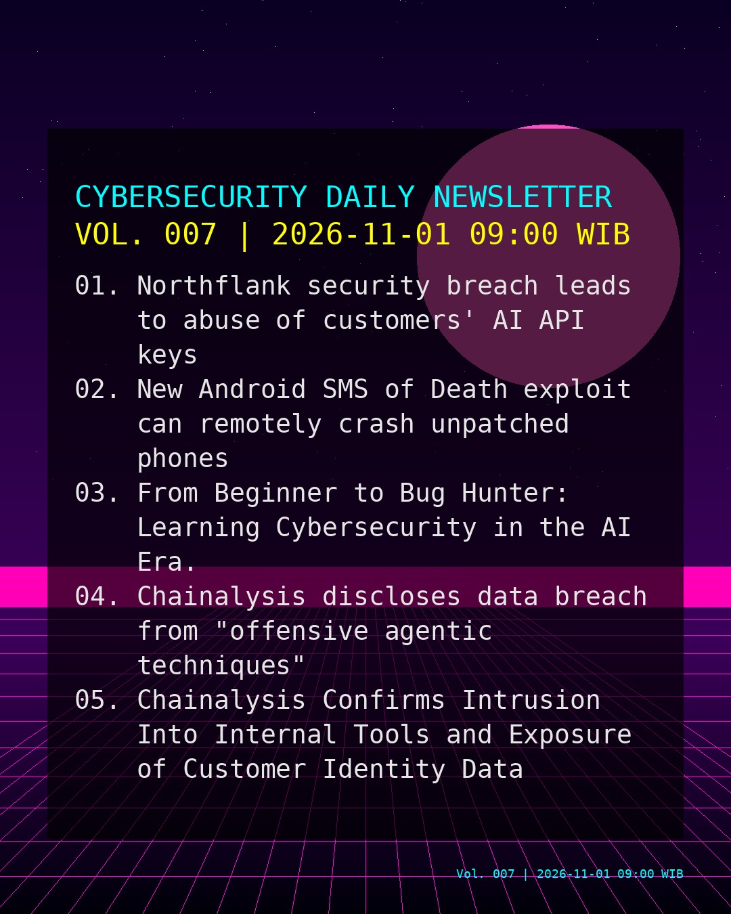
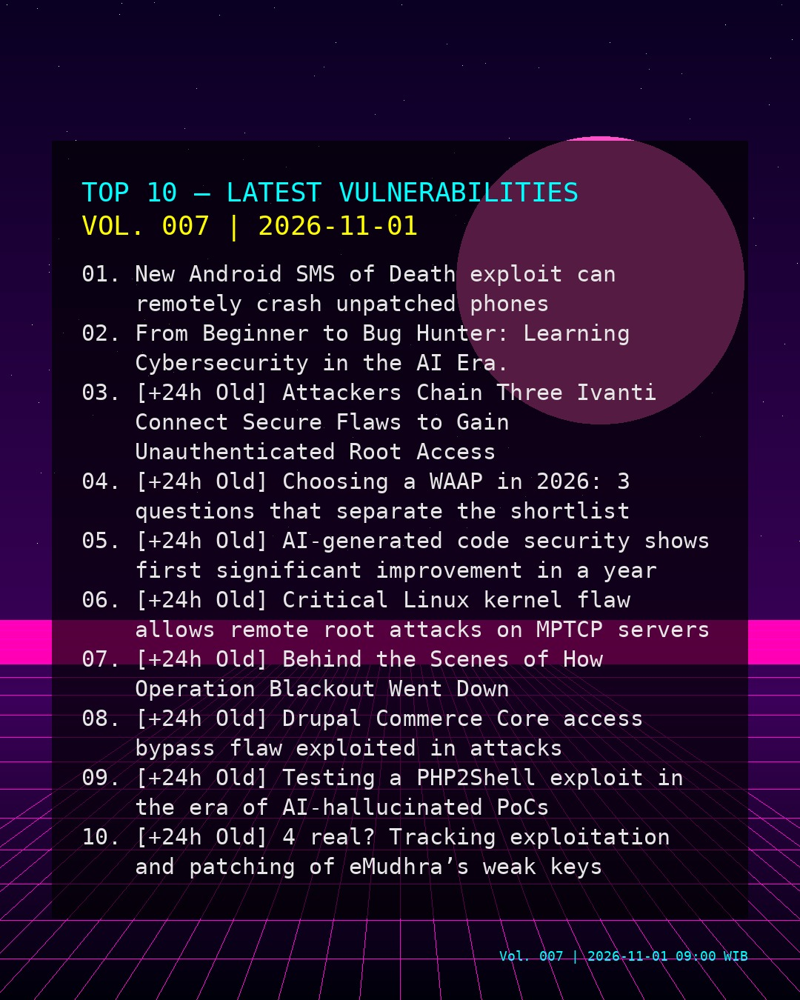
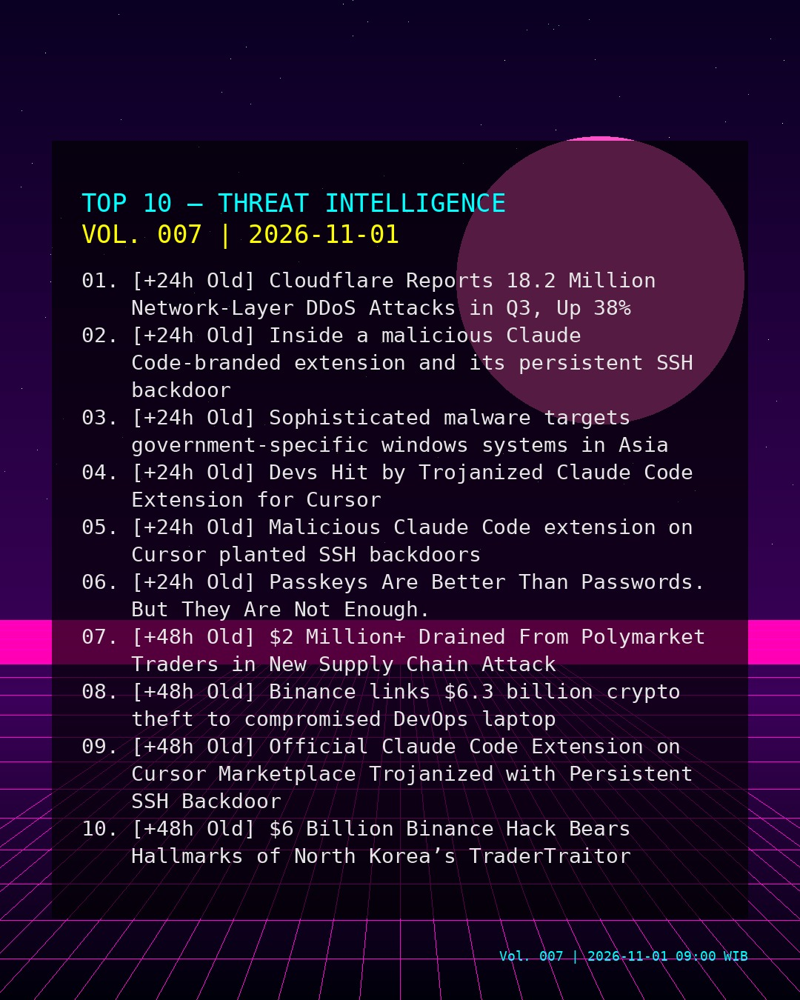
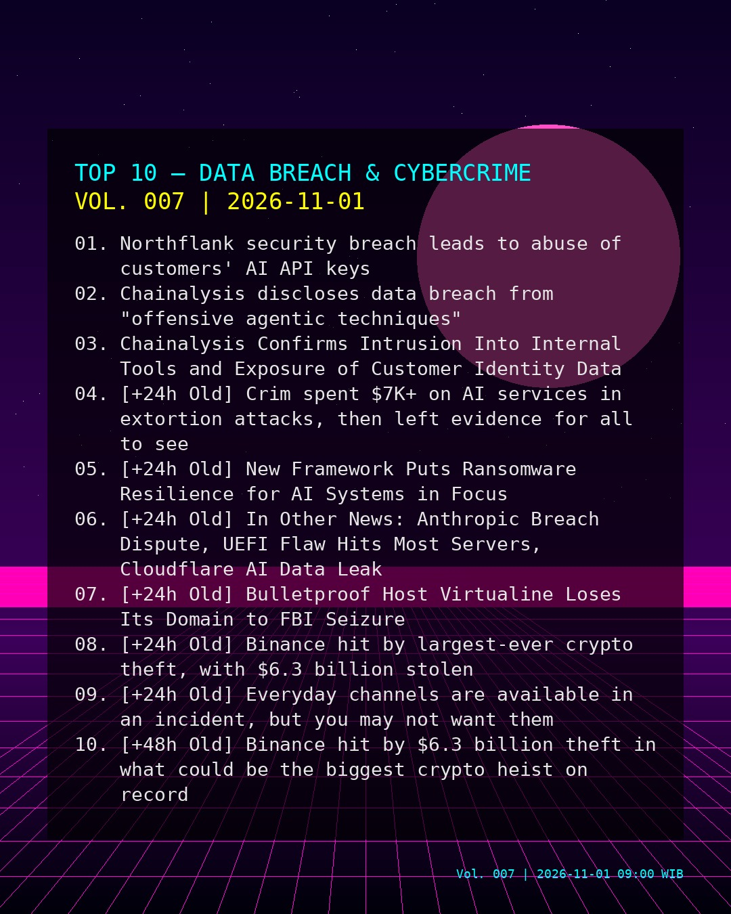

# Cyber News Daily Updates

This repository stores **daily cybersecurity newsletters**.

## Support Me by Ko-fi
 https://ko-fi.com/mirfansulaiman

<!-- DAILY_UPDATES_START -->
## Today Updates: [Vol. 007 | 2026-11-01 09:00 WIB]

Today's highlights are led by exploit-ready vulnerabilities: New Android SMS of Death exploit can remotely crash unpatched phones and From Beginner to Bug Hunter: Learning Cybersecurity in the AI Era.. Treat newly published PoCs and early exploitation signals as immediate patch/mitigation triggers for internet-facing and fleet-wide infrastructure.

Endpoint posture is also under pressure: Inside a malicious Claude Code-branded extension and its persistent SSH backdoor. Tighten EDR coverage, block known IoCs where available, and validate software supply-chain integrity in build and CI/CD.

Identity and edge access risks remain elevated: Northflank security breach leads to abuse of customers' AI API keys. Prioritize MFA enforcement, phishing-resistant authentication, and reduce management-plane exposure for edge services and remote access.

### TOP 10 - VULNERABILITIES

### TOP 10 - THREAT INTEL

### TOP 10 - DATA BREACH & CYBERCRIME

### PDF Report

Download: https://raw.githubusercontent.com/mirfansulaiman/cyber_news_daily_updates/main/Report/2026/2026-11-01/cyber_newsletter_2026-11-01.pdf

<!-- DAILY_UPDATES_END -->

## Data Source
RSS allowlist: https://github.com/netsecid/cybersecurity-rss-sources

